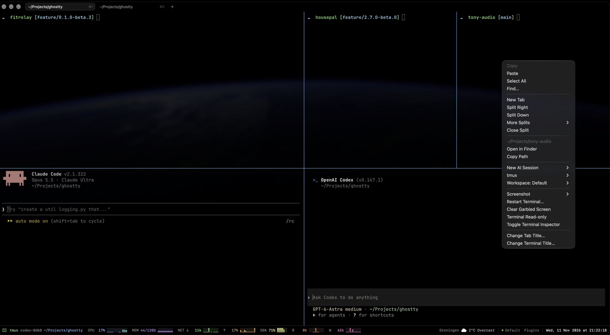

# Ghostty Status Lab

An experimental macOS build of [Ghostty](https://ghostty.org) with a status bar,
plugins, workspaces, tmux panes and AI sessions. It runs as a separate app next to your
normal Ghostty and leaves it untouched.

**Not an official Ghostty release and not a pull request.** I am sharing it to start a
conversation about which of these ideas could fit Ghostty.



## Features

| | |
| --- | --- |
| **Status bar** | CPU per core, memory, network, disk, weather and the time below the splits, outside the terminal grid. Every item is a plugin. |
| **Plugin Manager** | Every plugin, built-in or installed, with its version and whether it runs. Turn plugins on or off, place them left or right, install plugin packages. ⌥⌘P |
| **Workspaces** | Your windows, tabs, splits, directories and recent output always belong to a workspace that saves itself. Reopens at launch, also after a crash. Switch workspaces, open earlier versions. ⇧⌘S |
| **tmux panes** | Sessions that keep running when Ghostty quits or crashes, can be attached from any terminal, and come back with their history after a restart. |
| **AI sessions** | Right-click a pane › New AI Session › Claude Code, Codex or any tool you configure, in that pane's directory, in a tmux session. |
| **Context menu** | Right-click (also inside tmux): copy and paste, splits and tabs, the pane's directory, tmux, AI sessions, workspaces. |
| **Restart Terminal** | Revive a hung pane without closing the window: stops everything on its terminal and starts a fresh shell in the same place. |
| **Tab strip** | Compact tabs that blend with the background; hidden with the menu bar in fullscreen. |

## Install

Requires the toolchain from [`HACKING.md`](../../HACKING.md): Zig, Xcode with the Metal
toolchain, and Nushell. From the repository root:

```sh
python3 macos/StatusLab/build.py --bundle-id com.yourname.ghostty.statuslab
open "zig-out/status-lab/Ghostty Status Lab.app"
```

The app gets its own name, bundle identifier and settings, so it runs beside Ghostty.
It is signed ad hoc for the Mac that built it. `--skip-core` reuses an already built
`macos/GhosttyKit.xcframework`; `--name` and `--output` change the app name and folder.

## Configure

Everything is a normal Ghostty configuration. On first launch the app writes
`~/Library/Application Support/<bundle id>/config.ghostty` from
[`status-lab.config`](status-lab.config): Dracula on black, JetBrains Mono, the tab strip,
split keybindings and session restore. Edit it like any Ghostty configuration and reload
with ⇧⌘, .

Status Lab adds one option:

```ini
# AI tools in the right-click menu: name, command, and what runs after a restart.
macos-ai-session = name:Claude Code,command:claude,resume:claude --continue
macos-ai-session = name:Codex,command:codex,resume:codex resume --last
```

Plugin choices are made in the Plugin Manager; it writes the plugin manifest that the
app passes to Ghostty's `macos-status-plugins` option. tmux profiles live there too.

## How it works

- **Plugins are separate processes.** A plugin writes small JSON snapshots to stdout;
  it cannot draw its own UI or touch terminal input or output. A failing plugin is
  restarted with backoff without affecting the others. All windows share one set of
  plugin processes. See [PLUGINS.md](PLUGINS.md) to write and share one.
- **Sessions belong to the app.** Checkpoints are compared cheaply every few seconds and
  written atomically; the full scrollback is read only when quitting and before sleep.
  A damaged checkpoint falls back to an earlier one. Each launch keeps a backup of
  what it replaced.
- **tmux runs on its own.** When no tmux server runs, Ghostty starts one as a launchd job
  of your user. Quitting or a crash of Ghostty only detaches; programs such as Claude
  keep running. Normal panes come back as new shells with their earlier output.
- **Normal Ghostty builds are unaffected.** Everything is active only when the app's
  Info.plist contains `StatusLabVersion`, which only `build.py` adds.

## Limitations

- macOS only.
- Plugins run with your permissions and are not sandboxed; install only plugins you trust.
- Programs in normal panes do not survive a restart; use a tmux pane for those.
- Tabs in the tab strip cannot be dragged.
- Ad-hoc signed: runs on the Mac that built it. Distribution needs a Developer ID.

## About

I used iTerm2 for about fifteen years and switched to Ghostty, but missed my status bar,
getting my sessions back after a crash, and long-running Claude Code sessions. I built
these changes with AI coding agents (OpenAI Codex and Anthropic Claude) during daily use.
Take what is useful; much of it would change, or be done differently, if any of it were
ever considered for Ghostty itself.

Tested with the Swift test suite (plugin protocol and host, settings, plugin packages,
session snapshots, tmux and AI session commands checked against a real shell), with real
tmux and launchd processes, and in daily use.

[Changelog](CHANGELOG.md) · [Writing plugins](PLUGINS.md) · Feedback is very welcome.
